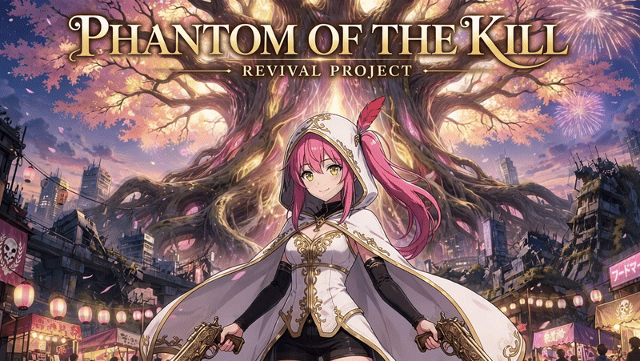
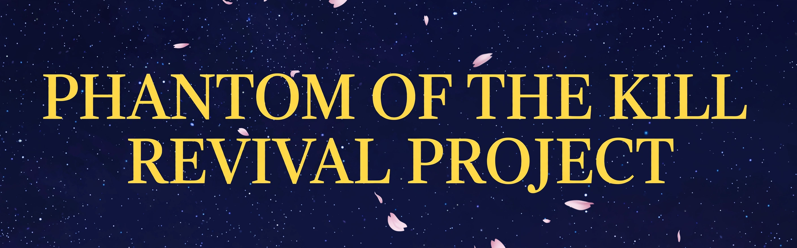

<i>The game ended. The party didn't.</i>

  
  
  
  

---

### 🎮 The Revival

We're rebuilding the game server so the original game runs again.

**✅ Working Now:**
- Story quest works end to end
- Units and gear can merge and be viewed
- The shop works
- iOS and Android test builds shared with the team
- Gacha screen live in the beta build

**🔜 Next Up:**
- Player level-up

### 🎬 The Anime

**Freikugel: The Seventh Bullet** — a new seven-minute silent episode every night at 10 PM CT, with fansub subtitles and signing.
Frei, her Master, and the Killer Princesses repair the memories of a dead game, one night at a time.
Latest: Episode 10, 'The Seventh Night,' released November 26, 2026.

> New episodes drop nightly in **#showcase** on Discord.

### 👥 The Team

| Role | Member |
| :--- | :--- |
| **Project Lead** | MasqueradeFer |
| **Game Server** | dedicatus |
| **Game Data & Summon UI** | hirotokagami |
| **Viewer & Archive** | cilantro07 |

### 📦 Repositories

| Repo | What It Is |
| :--- | :--- |
| [**downloads**](https://github.com/phantom-of-the-kill-revival/downloads) | Game builds, server files, tools & the full Discord download catalog (live) |
| `server` | The revival game server (coming soon) |
| `game-data` | Quest tables, summon costs & UI (coming soon) |

### 💬 Join Us

**Discord:** https://discord.gg/r7ukGMF6eB

---

<i>We're bringing Phantom of the Kill back — server, community, and a new episode every night.</i>

