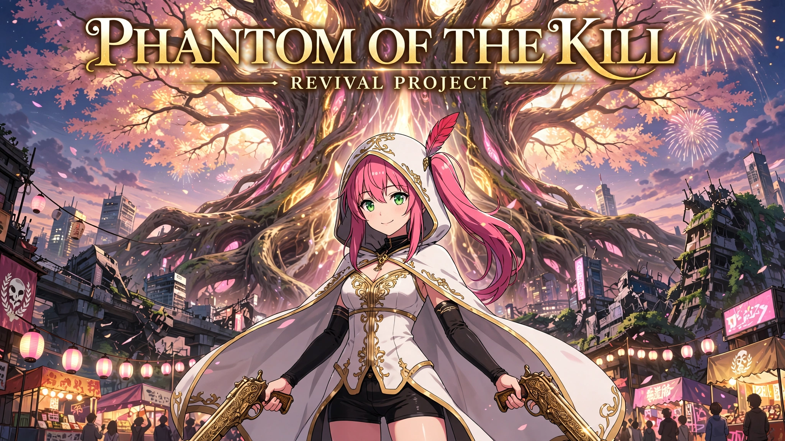

# Phantom of the Kill Revival Project

> The game ended. The party didn't. We're bringing Phantom of the Kill back — server, community, and a new episode every night.

## The revival

We're rebuilding the game server so the original game runs again. Where we stand:

- Story quest works end to end
- Units and gear can merge and be viewed
- The shop works
- iOS test build shared with the team
- Next up: player level-up, then gacha

## The anime

**Freikugel: The Seventh Bullet** — a new five-minute silent episode every night at 10 PM CT, with fansub subtitles and signing. Frei, her Master, and the Killer Princesses repair the memories of a dead game, one night at a time.

## The team

- **MasqueradeFer** — Project Lead
- **dedicatus** — game server
- **hirotokagami** — game data & summon UI
- **cilantro07** — viewer & archive

## Join us

- Discord: https://discord.gg/r7ukGMF6eB
- New episodes drop nightly in #showcase

## Repositories

- `server` — the revival game server (coming soon)
- `game-data` — quest tables, summon costs & UI (coming soon)
